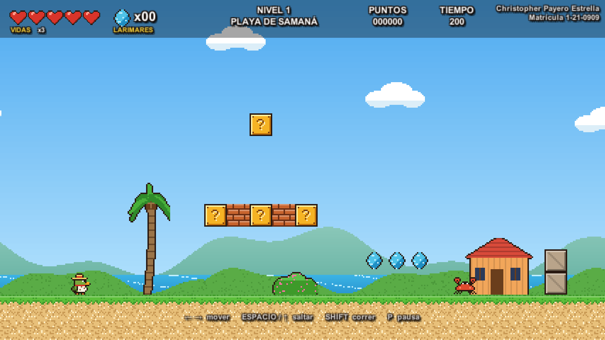

# Ciguín y la Leyenda del Galipote

Videojuego de **plataformas 2D** hecho en **Unity 6** para la asignatura **Programación de Videojuegos**.

**Alumno:** Christopher Payero Estrella — **Matrícula:** 1-21-0909

**Jugar en línea:** https://christ2723.github.io/Ciguin/

**Documentación (PDF):** [`Documentacion/Ciguin_Documentacion.pdf`](Documentacion/Ciguin_Documentacion.pdf)



## Historia

Ciguín es una pequeña cigua palmera (el ave nacional dominicana) con sombrero de guano.
El **Galipote**, el ser del folclor que cambia de forma, se robó los larimares de la isla y llenó la playa,
la cueva y la loma de criaturas. Ciguín debe cruzar los tres niveles y derrotarlo.

## Controles

| Acción | Teclas |
|---|---|
| Moverse | ← → o A D |
| Saltar (mantener = más alto) | Espacio, ↑, W o Z |
| Correr | Shift o X |
| Pausa | P o Esc (en pausa, M = menú) |
| Menú | Enter o el ratón |

## Requisitos de la tarea

| Requisito | Cómo se cumple |
|---|---|
| Juego de plataformas (esquivar, llegar a un punto en un tiempo, vidas, objetos) | Hay que llegar a la bandera antes de que se acabe el tiempo; 3 vidas (corazones, máximo 5); se recogen larimares (50 = 1 vida) y mangos (+1 vida) |
| Al menos 3 niveles | Nivel 1 *Playa de Samaná* → Nivel 2 *Cueva de las Maravillas* → Nivel 3 *Loma del Galipote* (jefe) |
| Sin vidas o sin completar el nivel → volver al primero | Al quedarse sin vidas o sin tiempo (en cualquier nivel) aparece **"¡CIGUÍN HA MUERTO!"** y se vuelve al Nivel 1 |
| Mínimo 5 tipos de enemigos u obstáculos | Cangrejo, murciélago, cactus lanzador, cocos/estalactitas que caen, púas, plataformas que se caen, agua y el jefe Galipote |
| Un jugador que se mueve, salta, salta sobre enemigos y golpea bloques | Ciguín camina, corre, salta (altura variable), aplasta enemigos, golpea bloques sorpresa y rompe ladrillos |
| Sonido: efectos, música de fondo y música distinta en el jefe | 20 efectos + música de menú, de cada nivel, del jefe (cambia al entrar a la arena) y de victoria |
| Menú de inicio y mensaje de muerte | Menú con Jugar / Cómo jugar / Historia; mensaje "¡CIGUÍN HA MUERTO!" con el motivo |

## Cómo está hecho

Todo el contenido (sprites en pixel art, sonidos, música, prefabs y escenas) lo genera
`Assets/Editor/ConstructorProyecto.cs` desde el menú **Ciguin → Construir todo**, así los personajes son originales.

| Carpeta / script | Función |
|---|---|
| `Scripts/Juego` | Vidas, larimares, puntos y audio (persiste entre escenas) |
| `Scripts/Nivel` | Tiempo, HUD, puntos de control, muerte, nivel completado, pausa y jefe |
| `Scripts/Jugador` | Movimiento, salto con *coyote time*, pisotón, golpe de bloques, animación |
| `Scripts/Enemigos/*` | `Cangrejo`, `Murcielago`, `CactusLanzador`, `ObjetoQueCae`, `Peligro`, `Proyectil`, `Jefe` |
| `Scripts/Objetos/*` | `Bloque`, `Larimar`, `Mango`, efectos |
| `Scripts/Escenario/*` | Cámara, parallax, plataformas móviles y que caen, meta, punto de control, arena del jefe |
| `Scripts/Interfaz/*` | Menú principal y pantalla de victoria |
| `Editor/PruebaAutomatica` | Prueba en modo Play que recorre el juego completo y verifica cada requisito |

### Compilar

```
Unity -batchmode -quit -projectPath . -executeMethod ConstructorProyecto.ConstruirTodo
Unity -batchmode -quit -projectPath . -buildTarget WebGL -executeMethod ConstructorProyecto.CompilarWebGL
```
